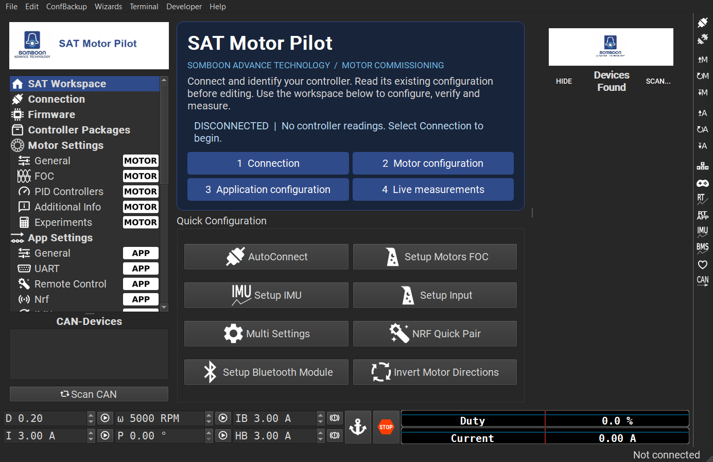
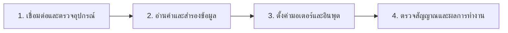

<div align="center">


# SAT Motor Pilot

**เครื่องมือตั้งค่าและตรวจสอบระบบมอเตอร์สำหรับ Windows โดยสมบูรณ์**


[ดาวน์โหลด V0.3.1](https://github.com/poommyroboticcamera-netizen/SAT-Motor-Pilot/releases/latest) · [เริ่มใช้งาน](#เริ่มใช้งาน) · [ความสามารถ](#ความสามารถ) · [ผลทดสอบ](#ผลทดสอบ) · [Build จากซอร์ส](#build-จากซอร์ส)

</div>

## เกี่ยวกับโปรเจกต์

**SAT Motor Pilot** เป็นแอปสำหรับเชื่อมต่อ controller อ่านและปรับค่ามอเตอร์ ตรวจสัญญาณ และวิเคราะห์ข้อมูลการทำงาน เหมาะกับงานเตรียมระบบ ทดสอบบนโต๊ะ LAB และตรวจสอบการตั้งค่าก่อนนำไปใช้งาน

แอปมีชื่อ หน้าจอ และขั้นตอนใช้งานของสมบูรณ์เอง เปิดใช้งานได้โดยไม่ต้องติดตั้งหรือเปิด VESC Tool ส่วนระบบสื่อสารพัฒนาต่อจากโค้ด GPL เพื่อรักษาความเข้ากันได้กับบอร์ดที่ใช้โปรโตคอล VESC



[ดูแอนิเมชันเปิดแอป](evidence/ui/motorlab/startup.mp4)

### รูปแบบหน้าจอ

- **ดำและเทาเข้มเป็นหลัก** ใช้สีน้ำเงินบริษัทเน้นปุ่มและสถานะที่เลือก
- **ตัวอักษรหัวข้อทรงแคบหนา** รองรับ Muffie ที่ติดตั้งหรือมีไฟล์สิทธิ์ใช้งาน ชุดนี้ใช้ Impact สำรอง; ข้อความตั้งค่าและตัวเลขยังอ่านชัด
- **รูปแบบเครื่องมือ LAB** มุมเกือบเหลี่ยม เส้นแบ่งชัดเจน และคำสั่งอยู่ด้านบน
- **แอนิเมชันเปิดแอป** โลโก้สมบูรณ์ค่อย ๆ ปรากฏบนพื้นดำ พร้อมเส้นแสดงการเริ่มทำงานประมาณ 1.6 วินาที ก่อนเข้าสู่หน้าหลัก
- **โลโก้โปร่งใส** กลมกลืนกับพื้นหลัง ไม่มีแผ่นพื้นขาว
- **Manual drive พับเก็บได้** เปิดเฉพาะเมื่อต้องการควบคุมด้วยตนเอง การเปิดแผงไม่ส่งคำสั่งมอเตอร์

## ขั้นตอนทำงาน



| พื้นที่ทำงาน | ใช้สำหรับ |
|:--|:--|
| **Overview / Motor control lab** | เริ่มงาน ดูสถานะ และเปิดขั้นตอนตั้งค่าที่ต้องใช้ |
| **Device link** | เลือกการเชื่อมต่อ ตรวจ port และข้อมูล firmware |
| **Motor workspace** | ตั้งค่ามอเตอร์ วิธีควบคุม ขีดจำกัด และ PID |
| **Input workspace** | ตั้งค่า UART, PPM, ADC, remote และอินพุตอื่น |
| **Measurement lab** | เปิด live scope, sampled data และเครื่องมือวิเคราะห์ |
| **Session tools** | เข้าถึงคำสั่งและเครื่องมือเพิ่มเติมของ controller |

สถานะบนหน้าจอมาจากการเชื่อมต่อจริง เมื่อยังไม่ต่ออุปกรณ์จะแสดง **NO DEVICE SESSION / DISCONNECTED**

## ความสามารถ

| กลุ่ม | ขอบเขตที่มีในแอป |
|:--|:--|
| การเชื่อมต่อ | Serial/USB, BLE, TCP/UDP และ CAN forwarding |
| การตั้งค่ามอเตอร์ | BLDC, DC, FOC, GPDrive, PID และพารามิเตอร์ตาม firmware |
| การตั้งค่าอินพุต | PPM, ADC, UART, NRF, PAS, IMU และ remote control |
| ข้อมูลและการวิเคราะห์ | Realtime data, sampled data, experiments, BMS, IMU และ log analysis |
| เครื่องมือวิศวกรรม | Terminal, LispBM, QML, SWD, ESP programmer และ controller packages |
| ไฟล์ตั้งค่า | อ่าน/บันทึก XML และสำรอง configuration |

การมีเครื่องมือในแอปไม่ได้หมายความว่าทดสอบกับฮาร์ดแวร์ครบทุกแบบแล้ว รุ่นนี้ยังเป็น **Engineering Preview** ดู [สถานะการรับรองและข้อจำกัด](docs/ACCEPTANCE_AND_KNOWN_ISSUES.md)

## เริ่มใช้งาน

ดาวน์โหลด **`SAT-Motor-Pilot-Windows-x64.zip`** จาก [GitHub Releases](https://github.com/poommyroboticcamera-netizen/SAT-Motor-Pilot/releases/latest) รุ่นล่าสุด **V0.3.1**

1. แตก ZIP ทั้งโฟลเดอร์ แล้วเปิด `SATMotorPilot/SATMotorPilot.exe`
2. เก็บ DLL และโฟลเดอร์ `platforms`, `qml` ไว้ข้างไฟล์แอปตามเดิม
3. ทำตามคำแนะนำครั้งแรก แล้วเปิด **Device link**
4. เมื่อตรวจพบ controller ให้ตรวจรุ่น firmware และอ่านค่าก่อนแก้ไข

### เชื่อมต่อบอร์ด VESC

แอปคงระบบสื่อสารและการตรวจ firmware ของ compatibility core จึงออกแบบให้เชื่อมต่อบอร์ด VESC ได้ เริ่มจากจ่ายไฟตามข้อกำหนดของบอร์ด ต่อสาย USB ที่ส่งข้อมูลได้ เลือก port ใน **Device link** แล้วเชื่อมต่อ จากนั้นตรวจ firmware และใช้ **Read motor / Read inputs** เพื่ออ่านค่า

ความเข้ากันได้ขึ้นกับบอร์ดและ firmware ที่ติดตั้ง รุ่นอ้างอิงของโครงการคือ **7.00** หากแอปแจ้ง firmware ไม่รองรับ ให้ตรวจข้อมูลให้ตรงก่อนใช้คำสั่งเขียนค่า ตรวจมอเตอร์ หรือแฟลช firmware ดู [ขอบเขตความเข้ากันได้](docs/REFERENCE_AND_COMPATIBILITY.md)

ปุ่ม **Write motor / Write inputs** บนแถบหลักมีขั้นตอนอ่านค่าปัจจุบัน สำรองข้อมูล แสดงรายการเปลี่ยนแปลง ขอการยืนยัน และตรวจอ่านกลับ ส่วน **Output off** ใช้กับ controller ที่เลือก ไม่ใช่ emergency stop ของทุกอุปกรณ์บนระบบ

### อัปเดตไฟล์เดิม

ไฟล์ที่ build อยู่ที่ `dist/SATMotorPilot/SATMotorPilot.exe` และ ZIP ใช้ชื่อเดิมทุกครั้ง ปิดแอปก่อนเขียนทับโฟลเดอร์เดิม ไม่ต้องแยกโฟลเดอร์ตามเลขเวอร์ชัน

## ผลทดสอบ

ผลต่อไปนี้เป็นการทดสอบโปรแกรมและไฟล์บน Windows โดย **ยังไม่ได้ต่อ controller จริง**

| การตรวจ | ผลล่าสุด |
|:--|:--|
| Build และเปิดแอป | เปิดด้วย runtime ที่มากับแพ็กเกจ โดยไม่พึ่ง Qt จาก PATH ของเครื่อง |
| ส่วนติดต่อผู้ใช้ SAT | **14 runtime checks ผ่าน**, 0 failed และ 1 source review |
| การนำทางหน้าแรก | ทางลัดทั้ง 4 เปิดหน้าทำงานที่ถูกต้อง |
| Manual drive | เปิด/ปิดได้ พับเก็บตั้งแต่เริ่ม และไม่ส่ง command จากการเปิดแผง |
| Packet และการแปลงข้อมูล | **11 passed, 0 failed** รวม init/cleanup; มี 9 test methods |
| Compatibility core | **88/88 checks** ในขอบเขต command, packet, serializer, schema และ transport ที่ตรวจ |
| บันทึก/โหลด XML | Motor 211 parameters และ application 122 parameters คืนค่าตรงหลังโหลด |
| การแสดงหน้าจอ | บันทึกภาพ 33 รายการหน้าในสถานะไม่เชื่อมต่อ |

หลักฐาน: [Runtime audit](evidence/ui/motorlab/runtime-audit.json) · [ผลทดสอบ SAT](evidence/company-product-acceptance.json) · [Protocol tests](validation/results/protocol-tests.txt) · [Core regression](evidence/company-core-regression.json) · [Delivery manifest](evidence/delivery-manifest.json)

งานที่ยังต้องยืนยันกับอุปกรณ์จริง ได้แก่ การอ่าน/เขียน controller, motor detection, การขับมอเตอร์, live telemetry, reconnect, BLE/CAN และ firmware flashing ผลข้างต้นไม่ใช้รับรองความเข้ากันได้กับทุกบอร์ด Audit บล็อกการส่ง packet ออกฮาร์ดแวร์

Direct PC CAN adapter ต้องใช้ build ที่เปิด `HAS_CANBUS` ซึ่งชุด default นี้ไม่ได้เปิด ส่วน CAN forwarding เป็นการสื่อสารผ่าน controller ที่เชื่อมต่อ

## Build จากซอร์ส

ใช้ **Windows x64, Git, Python 3, PowerShell และ Qt 5.15.2 / MinGW 8.1 x64** ให้ตรงกับโครงการ

```powershell
git clone https://github.com/poommyroboticcamera-netizen/SAT-Motor-Pilot.git
cd SAT-Motor-Pilot
./bootstrap.ps1
./build.ps1 -Clean
```

`bootstrap.ps1` เตรียม toolchain ใน `tooling/` ของโครงการ หากมี Qt อยู่แล้ว ระบุตำแหน่งด้วย `./build.ps1 -QtRoot C:/path/to/Qt`

```powershell
./validation/run-protocol-tests.ps1
python validation/verify_compatibility_core.py
./validation/run-ui-audit.ps1
python validation/record_company_acceptance.py
```

โปรเจกต์หลัก: `source/sat_motor_pilot.pro` ผลลัพธ์: `dist/SATMotorPilot/`

## เอกสารเพิ่มเติม

- [ขอบเขตผลิตภัณฑ์ของสมบูรณ์](docs/COMPANY_PRODUCT.md)
- [สถานะการรับรองและข้อจำกัด](docs/ACCEPTANCE_AND_KNOWN_ISSUES.md)
- [ขั้นตอนยืนยันการเขียนค่า](docs/CONFIGURATION_WRITE_SAFETY.md)
- [แหล่งอ้างอิงและความเข้ากันได้](docs/REFERENCE_AND_COMPATIBILITY.md)
- [หลักฐานการตรวจไฟล์แอปด้วย REA](docs/REA_FINDINGS.md)
- [ประวัติการเปลี่ยนแปลง](source/res/sat_changelog.md)

## แหล่งที่มาและไลเซนส์

SAT Motor Pilot พัฒนาต่อจาก VESC Tool stable **7.00** โดย Benjamin Vedder และผู้ร่วมพัฒนา ภายใต้ **GPL-3.0-or-later** เก็บเครดิตและข้อกำหนดเดิมไว้ โครงการนี้ไม่ได้อ้างว่าเขียน compatibility engine ขึ้นใหม่ทั้งหมด หรือได้รับการรับรองจากเจ้าของโครงการต้นทาง

Source reference: `01d5f10901116c311e3fb84d5a1541f663d3ce20` · Firmware reference: `26af69484014b6771d02e68c22f4cb96645b5f22`

โลโก้ Somboon Advance Technology เป็นภาพที่ผู้ใช้จัดส่ง รุ่นนี้ใช้ภาพดัดแปลงพื้นโปร่งใสและเก็บต้นฉบับไว้ ดู [LICENSE](LICENSE) และ [THIRD_PARTY_NOTICES](THIRD_PARTY_NOTICES.md) สำหรับเครดิตและรายการ resource ที่ยังต้องตรวจสอบก่อนเผยแพร่ binary สาธารณะ
