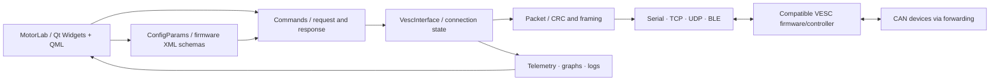

<div align="center">


# SAT Motor Pilot · MotorLab

**แอป Windows สำหรับตั้งค่า ควบคุม และตรวจข้อมูลมอเตอร์ โดยต่อยอดจาก VESC Tool 7.00 พร้อม source และหลักฐานตรวจสอบ**


[ภาพรวม](#ภาพรวม) · [ความสามารถ](#ความสามารถและขอบเขต) · [เริ่มใช้งาน](#เริ่มใช้งานบน-windows) · [Build](#build-จาก-source) · [ผลตรวจ](#การตรวจสอบและหลักฐาน) · [แหล่งอ้างอิง](docs/REFERENCE_AND_COMPATIBILITY.md)

</div>

---

## ภาพรวม

**SAT Motor Pilot** เป็นชื่อ repository ส่วนโปรแกรมใช้ชื่อ **MotorLab** พัฒนาจาก source ของ VESC Tool รุ่น stable 7.00 โดยคงหน้าจอ ขั้นตอนตั้งค่า ระบบพารามิเตอร์ และโครงสร้างสื่อสารต้นทางไว้ แล้วปรับชื่อโปรแกรม โลโก้ ไอคอน และข้อมูล About ให้ระบุโครงการนี้อย่างชัดเจน

แนวทางนี้ช่วยรักษาความต่อเนื่องของ workflow เช่น Connection → อ่าน configuration → ตั้งค่า Motor/App → ตรวจ telemetry โดยไม่สร้างหน้าจอจำลองแทนระบบตั้งค่าจริง ข้อมูลจากอุปกรณ์ยังต้องมาจากการตอบกลับของ controller ผ่านระบบสื่อสารเดิม

> [!IMPORTANT]
> **สถานะ 22 ตุลาคม 2026: Engineering preview** ผล unit test ของ packet/serializer และ local configuration XML round trip ผ่านแล้ว มีภาพ disconnected UI 33 page rows แต่ยังไม่มีผลยืนยันทุก control ทุก wizard ทุก transport หรือการทำงานกับมอเตอร์จริง การใช้ source ร่วมกันยังไม่ใช่หลักฐานว่าเหมือนต้นฉบับทุกพิกเซลหรือผ่านการทดสอบฮาร์ดแวร์แล้ว

<div align="center">

<sub>ภาพจาก runtime audit ในสถานะ disconnected; รอบแรกใช้ offscreen renderer ภาพนี้ไม่ใช่ผลทดสอบมอเตอร์</sub>
</div>

## ความสามารถและขอบเขต

ตารางนี้ระบุความสามารถที่สืบทอดอยู่ใน source และข้อจำกัดของหลักฐานปัจจุบัน คำว่า “มีใน source” ไม่ได้หมายถึงผ่านการทดลองกับอุปกรณ์จริงแล้ว

| กลุ่มงาน | หน้าจอ / ระบบที่มีใน source | สถานะการยืนยัน |
|:--|:--|:--|
| เริ่มต้น | Welcome, motor/app setup wizards, calculators | รอทดสอบ workflow ทุกขั้น |
| การเชื่อมต่อ | Serial/USB, TCP, UDP, Bluetooth/BLE และ CAN forwarding | รอทดสอบแต่ละ transport กับ controller |
| Motor configuration | General, BLDC, DC, FOC, GPDrive, PID, motor information | Local XML round trip ผ่าน; ยังไม่ทดสอบ physical controller read/write |
| App configuration | PPM, ADC, UART, remote, NRF, PAS, IMU | Local XML round trip ผ่าน; ยังไม่ทดสอบอินพุตจริง |
| Telemetry | Realtime, sampled data, experiment plot, IMU และ BMS | รอเทียบข้อมูลและกราฟจาก fixture/controller |
| วิเคราะห์ข้อมูล | Log analysis, motor analysis, import/export | รอทดสอบไฟล์และค่าผลลัพธ์ |
| เครื่องมือพัฒนา | Terminal, QML, LispBM, CAN tools, display/debug tools | มีใน source; รอ acceptance รายฟังก์ชัน |
| Firmware / programming | Firmware workflow, SWD/ESP tools, packages | ยังไม่ทดสอบ download/flash หรืออุปกรณ์จริง |
| Protocol | CRC, frame encode/decode, fragmentation, scalar serialization | **QtTest 11 passed, 0 failed** รวม init/cleanup |
| Branding | MotorLab title, About, logo และ settings namespace | รายละเอียดใน [branding](docs/branding.md) |

Direct PC CAN backend ต้องเปิด `HAS_CANBUS` และมี Qt CAN backend ที่เหมาะสม ค่า default ต้นทางไม่ได้เปิด flag นี้ ส่วน CAN forwarding ผ่าน VESC เป็นอีกเส้นทางหนึ่ง จึงไม่ควรใช้ผลของเส้นทางหนึ่งรับรองอีกเส้นทางหนึ่ง

## โครงสร้างระบบ



ระบบพารามิเตอร์เลือก schema และความสามารถตาม firmware ที่ตรวจพบ ไม่ควรสมมติว่าทุก command ใช้ได้กับ firmware ทุกเวอร์ชัน การ build นี้ยังคง `exclude_fw` ตาม default ของ upstream; ตัวแอปจึงไม่ได้บรรจุ firmware image ครบทุกบอร์ด

## รุ่นอ้างอิงที่ตรึงไว้

| ส่วนประกอบ | Reference | ขอบเขต |
|:--|:--|:--|
| Base application | [VESC Tool 7.00](https://github.com/vedderb/vesc_tool/commit/01d5f10901116c311e3fb84d5a1541f663d3ce20) | Commit `01d5f10901116c311e3fb84d5a1541f663d3ce20` |
| Matching firmware source | [bldc release 7.00](https://github.com/vedderb/bldc/commit/26af69484014b6771d02e68c22f4cb96645b5f22) | Source reference; ยังไม่ได้แฟลช firmware นี้ลงบอร์ด |
| Existing comparison binary | รายงานตัวเองเป็น `7.00-0+255006e8` | Qt6-port lineage ต่างจาก release source ที่เลือก |
| Build toolchain | Qt 5.15.2 / MinGW 8.1 / Windows x64 | ใช้สร้างโปรแกรมและ protocol tests |

เลือก commit ที่ประกาศ release 7.00 ชัดเจน แทนการนำ HEAD รุ่นทดสอบมาเรียกว่า stable ส่วน binary ที่ติดตั้งเดิมเป็นหลักฐานคนละชุดกับ source release นี้ อ่านเหตุผล hashes และข้อจำกัดได้ใน [Reference and compatibility](docs/REFERENCE_AND_COMPATIBILITY.md) และ [reference manifest](evidence/reference-manifest.json)

## เริ่มใช้งานบน Windows

1. ชุดทดลองที่เตรียมใน workspace ใช้ไฟล์ `MotorLab-Windows-x64-trial.zip` หรือเปิดจาก `dist/MotorLab/MotorLab.exe` หลัง build/deploy โครงการนี้ยังไม่มี public binary release; สำหรับการใช้งานจาก repository ให้ทำตาม [ขั้นตอน build](#build-จาก-source)
2. แตก ZIP ทั้งโฟลเดอร์ไว้ในตำแหน่งที่เขียนไฟล์ได้ และเปิด `MotorLab.exe` พร้อม DLL/plugins ที่มากับชุดเดียวกัน
3. เริ่มสำรวจหน้าจอในสถานะ offline ก่อนเชื่อมต่ออุปกรณ์ แล้วตรวจ firmware และชื่อ hardware ที่อ่านกลับได้ก่อนเปลี่ยนค่า
4. เก็บ configuration เดิมและตรวจค่าที่อ่านกลับก่อนใช้ wizard, calibration, firmware update หรือคำสั่งขับมอเตอร์

แพ็กเกจทดลองและผล host test ยังไม่รับรองความพร้อมของภาคกำลัง การคาลิเบรตกระแส หรือการหยุดมอเตอร์จริง ต้องตรวจบนชุดทดลองที่เหมาะกับ controller และมอเตอร์ของตนเอง

## Build จาก source

ใช้ Windows x64, PowerShell, Qt **5.15.2 MinGW 8.1 64-bit** Python 3 สำหรับ bootstrap, Git สำหรับ clone และ compiler ที่ตรงกับ Qt build หลีกเลี่ยงการผสม Qt DLL จากการติดตั้งคนละรุ่น

```powershell
git clone https://github.com/poommyroboticcamera-netizen/SAT-Motor-Pilot.git
cd SAT-Motor-Pilot
./bootstrap.ps1
./build.ps1
```

รายละเอียด option และตำแหน่ง output ให้อ่านจาก script ที่มากับ commit เดียวกัน หากเตรียม Qt เอง ใช้ qmake กับ `source/motorlab.pro` ใน build directory แยกจาก source แล้ว build ด้วย MinGW 8.1 ที่ตรงกัน

ทดสอบ protocol:

```powershell
./validation/run-protocol-tests.ps1
```

script ใช้ Qt จาก `tooling/Qt` ตามค่า default หรือระบุ `-QtRoot` ไปยังตำแหน่งติดตั้ง Qt ที่มีโครงสร้าง `5.15.2/mingw81_64` และ `Tools/mingw810_64`

## การตรวจสอบและหลักฐาน

ธีมบริษัทใช้โลโก้ **Somboon Advance Technology** ที่ผู้ใช้จัดส่ง และสีน้ำเงิน **#304B8A** ดู [ภาพเทียบก่อน/หลัง](evidence/ui/comparison/side-by-side-000.png), [UI comparison](docs/UI_COMPARISON.md), [ขั้นตอน Write ที่เพิ่ม](docs/CONFIGURATION_WRITE_SAFETY.md) และ [ผล REA](docs/REA_FINDINGS.md)


| การตรวจ | ผลที่มีหลักฐาน | ไฟล์ |
|:--|:--|:--|
| Original packet/serializer tests | **11 passed, 0 failed, 0 skipped**; 9 test methods และ init/cleanup | [ผลข้อความ](validation/results/protocol-tests.txt), [JUnit XML](validation/results/protocol-tests.junit.xml) |
| UI/function source inventory | 158 `.ui`/`.qml`, 5,170 traceability rows | [CSV](validation/ui-function-traceability.csv), [summary](validation/inventory-summary.json) |
| Parameter inventory | 6,606 รายการรวม schema หลาย firmware version | [Parameter CSV](validation/parameter-traceability.csv) |
| Command inventory | 157 active command IDs | [Command CSV](validation/command-traceability.csv) |
| Disconnected UI | บันทึก 33 visible page rows ของ reference และ MotorLab; ไม่ใช่ทุก control ผ่าน | [MotorLab audit](evidence/ui/motorlab/runtime-audit.json), [reference audit](evidence/ui/reference/runtime-audit.json) |
| Local config persistence | Motor 211 params / 488 bytes, App 122 params / 284 bytes; sentinel perturbation ก่อน load แล้ว diff กลับเป็น 0 | [Runtime results](evidence/ui/motorlab/runtime-audit.json) |
| Reference identity | Source commits, binary version/hash และข้อจำกัด | [Compatibility report](docs/REFERENCE_AND_COMPATIBILITY.md) |
| Test evidence identity | SHA-256 ของ original source, tests และผลที่ตรวจ | [Hashes](validation/test-evidence-sha256.json) |

QtTest compile จาก **original `packet.cpp` และ `vbytearray.cpp`** โดยตรง ครอบคลุม CRC known vector, frame ความยาว 1/255/256/10000 bytes, fragment ทุกจุดแบ่งของตัวอย่าง, รับทีละ byte, หลาย frame ต่อกัน, CRC/stop/length ผิด, reset ระหว่าง frame, integer endian/sign, fixed point และกรณีข้อมูลสั้น

ค่าคาดหวังเขียนแยกจาก production lookup table เช่น CRC-16/XMODEM ของ `123456789` เท่ากับ `0x31c3` จึงไม่ได้อาศัยเพียงการ encode/decode ด้วย implementation เดียวกัน รายละเอียดและวิธีทำซ้ำอยู่ใน [Validation README](validation/README.md)

**แถว form ที่มีภาพและจับคู่ source ได้ใช้ `RENDERED_ONLY`; แถว controls/actions/functions ยังคง `PENDING`** ต้องแนบผลจริงก่อนเปลี่ยนเป็นผ่าน โดยเฉพาะ timeout/reconnect, firmware negotiation, log import/export, connected-state pixel comparison และ wizard ทุกขั้น ผล local XML ตรวจ save/load ในเครื่องและ serialized bytes หลังเปลี่ยนค่า destination อย่างตั้งใจ ไม่ใช่ controller read/write หรือการทดสอบมอเตอร์ อ่าน [Acceptance และ known issues](docs/ACCEPTANCE_AND_KNOWN_ISSUES.md) สำหรับ evidence levels, runtime warnings และขั้นตอนทดสอบฮาร์ดแวร์ภายหลัง

## Repository layout

```text
SAT-Motor-Pilot/
├── source/                 Modified VESC Tool 7.00 source + retained licenses
├── docs/                   Branding and reference/compatibility reports
├── evidence/               Reference identity, build and UI evidence
├── validation/             QtTest, inventories and acceptance gaps
├── dist/MotorLab/          Local portable application after deployment
├── bootstrap.ps1           Toolchain setup
├── build.ps1               Windows build
└── THIRD_PARTY_NOTICES.md   Upstream, dependency and asset notices
```

## License และที่มาของโครงการ

MotorLab เป็น modified build ของ **VESC Tool โดย Benjamin Vedder และผู้ร่วมพัฒนา** source อยู่ภายใต้ **GPL-3.0-or-later** โดยเก็บ copyright headers และ [LICENSE ต้นทาง](source/LICENSE) ไว้ โปรแกรมนี้ไม่มีการรับประกัน และไม่ได้อ้างความเกี่ยวข้องหรือการรับรองจาก VESC Project

โลโก้บริษัท Somboon Advance Technology เป็นไฟล์ที่ผู้ใช้จัดส่งให้สำหรับโครงการนี้; ใช้ร่วมกับชื่อ MotorLab และธีมน้ำเงิน #304B8A โดยไม่ได้อ้างว่าเป็นโลโก้ภายใต้ GPL แต่ source ยังคงมี dependency, icons, fonts และ resource ต้นทางที่ต้องตรวจสิทธิ์แยกกัน อ่าน [THIRD_PARTY_NOTICES.md](THIRD_PARTY_NOTICES.md) เพื่อดูรายการและประเด็นที่ยังไม่ยืนยัน การเผยแพร่ binary ต้องแนบ corresponding source, build instructions และ notices ของ dependency ให้ครบตามเงื่อนไขที่เกี่ยวข้อง ไม่ควรตีความ GPL ของ source ว่ารับรองสิทธิ์ของ trademark หรือทุก asset โดยอัตโนมัติ

รูปแบบ README ต่อเนื่องจาก [ESC-FOC-Driver-V3.0](https://github.com/poommyroboticcamera-netizen/ESC-FOC-Driver-V3.0) และ [ESP32 Passive CAN Data Logger Dashboard](https://github.com/poommyroboticcamera-netizen/DATA-logging-dashboard-CANBUS) โดยเนื้อหา ผลตรวจ และขอบเขตทั้งหมดในหน้านี้เป็นของ MotorLab


